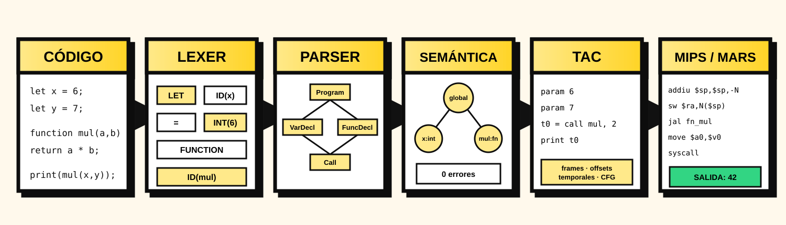
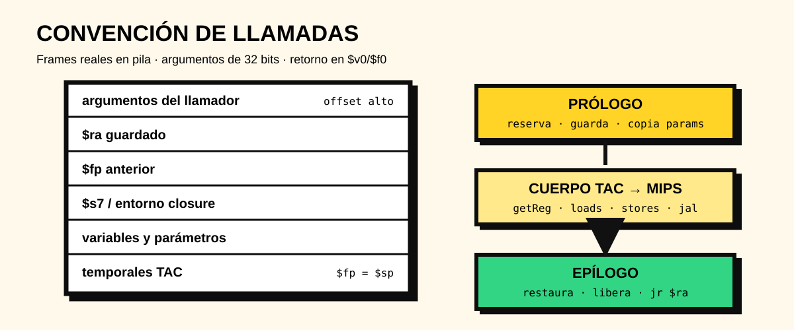

<div align="center">

# Compiscript MIPS Compiler IDE

### Proyecto 3 · Construcción de Compiladores · Sección 10

Compilador visual de Compiscript que recorre el frontend completo, genera TAC y lo traduce a ensamblador MIPS32 ejecutable en MARS 4.5.

[](#)
[](package.json)
[](https://www.antlr.org/)
[](https://dpetersanderson.github.io/)
[](#calidad-y-validación)
[](LICENSE)



**[Características](#características)** · **[Inicio rápido](#inicio-rápido)** · **[MARS](#ejecución-en-mars-45)** · **[Pruebas](#calidad-y-validación)** · **[Documentación](#documentación)**

</div>

---

## Alcance actual

El Proyecto 3 conserva el lexer y parser generados con ANTLR, el analizador semántico y el generador TAC de las entregas anteriores. La fase nueva consume **exclusivamente el TAC** y emite ensamblador MIPS32 compatible con MARS 4.5.

```text
Compiscript (.cps)
  → Lexer ANTLR
  → Parser ANTLR / CST
  → Visitor semántico / tabla de símbolos
  → TAC / frames / layouts
  → Backend MIPS32 / mirilla
  → archivo .asm para MARS 4.5
```

> [!IMPORTANT]
> Si existe al menos un error léxico, sintáctico o semántico, no se genera TAC ni ensamblador. Si el backend detecta un error interno o una referencia sin resolver, el resultado MIPS queda en estado `failed` y la interfaz deshabilita la exportación.

La aplicación **no ejecuta el ensamblador internamente** ni produce código objeto. El `.asm` se copia, descarga o guarda y se ejecuta con MARS, tal como permite el enunciado.

## Características

| Fase | Implementación |
| --- | --- |
| Lexer y parser | Código generado desde `Compiscript.g4` mediante ANTLR4TS |
| Recuperación | Recolección de múltiples errores, estrategia de parser y filtrado de cascadas |
| Semántica | Tipos, ámbitos, funciones, clases, arreglos, flujo, closures y tabla de símbolos |
| TAC | Cuádruplos tipados, temporales, etiquetas, CFG, frames y layouts de clases |
| MIPS32 | Aritmética, lógica, comparaciones, control, funciones, recursión, arreglos, objetos, strings, floats y closures |
| Convención de llamadas | Argumentos en pila, `$sp`, `$fp`, `$ra`, prólogo/epílogo y valor de retorno |
| Registros | Asignador `getReg` local a cada instrucción de tres direcciones y métricas de uso |
| Memoria | Segmento `.data`, heap mediante syscall 9, frames y entornos de closures |
| Mirilla | Elimina movimientos propios, ajustes nulos, saltos al bloque siguiente y `nop` duplicados |
| UI | Editor Monaco, selector `.cps`, pipeline, problemas, árboles, símbolos, TAC, MIPS y exportaciones |
| CLI | Modos `lexer`, `parser`, `semantic`, `tac` y `mips`, con salida `.asm` |

### Backend MIPS32

El backend se encuentra en [`src/mips/generator.ts`](src/mips/generator.ts). Recibe `TacGenerationResult`, resuelve cada operando contra registros de activación o memoria global y emite dos segmentos:

- `.data`: variables globales, temporales globales, constantes flotantes y cadenas;
- `.text`: `main`, funciones, saltos, llamadas, syscalls y runtime auxiliar.

Las funciones reservan un frame alineado, guardan `$s7`, `$fp` y `$ra`, copian los parámetros a sus slots y restauran el estado en un epílogo único. Las llamadas anidadas consumen solo los argumentos superiores de la pila, por lo que expresiones como `f(1, g(2))` y llamadas a métodos son seguras.



### Tipos y runtime

- `integer` y `boolean`: palabras de 32 bits;
- `float`: instrucciones del coprocesador 1 (`l.s`, `s.s`, `add.s`, `cvt.s.w`, etc.);
- `string`: direcciones a bytes terminados en cero, con rutinas de concatenación e igualdad;
- arreglos: palabra de longitud seguida por elementos;
- objetos: bloque de heap con offsets provenientes de `ClassLayout`;
- closures: puntero a función en la primera palabra y capturas a continuación.

## Inicio rápido

### Requisitos

- Node.js 22.12 o posterior;
- npm;
- Java para ejecutar MARS 4.5;
- Windows, macOS o Linux.

### Windows PowerShell

```powershell
Set-Location -LiteralPath "ruta\al\Proyecto-03_CDC_seccion-10_Grupo-DragonsSlayers-2.0"
npm.cmd ci
npm.cmd run verify
npm.cmd run dev
```

### macOS o Linux

```bash
cd Proyecto-03_CDC_seccion-10_Grupo-DragonsSlayers-2.0
npm ci
npm run verify
npm run dev
```

El IDE queda disponible en `http://localhost:3000`.

## Uso del IDE

1. Escribe código en el editor o usa **Archivo → Cargar .cps**.
2. Presiona **Analizar**.
3. El flujo normal para una entrada válida llega automáticamente hasta MIPS.
4. Inspecciona problemas, tabla de símbolos, ámbitos, árboles, TAC, frames y MIPS.
5. Descarga `compiscript.asm` desde el panel MIPS o Exportar.

El modo **Generación TAC** termina deliberadamente en la representación intermedia para una demostración focalizada. **Entrada válida**, **Archivo propio** y **Backend MIPS/MARS** ejecutan el pipeline completo.

## CLI y generación de `.asm`

```powershell
# Mostrar MIPS en la terminal
npm.cmd run cli:mips

# Compilar un archivo propio y guardarlo
npm.cmd run cli -- .\programa.cps --mode mips --out .\programa.asm

# Observar solo TAC
npm.cmd run cli -- .\programa.cps --mode tac
```

La CLI retorna código distinto de cero si una fase falla y nunca escribe el `.asm` cuando la compilación no es válida.

## Ejecución en MARS 4.5

MARS es una herramienta externa y no se incluye dentro del repositorio. En el equipo de desarrollo, el archivo está ubicado en:

```text
C:\Herramientas\Mars4_5.jar
```

Antes de continuar, verifica que Java y el JAR estén disponibles:

```powershell
java -version
Test-Path -LiteralPath "C:\Herramientas\Mars4_5.jar"
```

`Test-Path` debe devolver `True`. Si el archivo no está presente, descarga MARS 4.5 desde el [sitio oficial](https://dpetersanderson.github.io/) y colócalo en esa ruta.

### Opción 1: configurar MARS en la sesión actual

Ejecuta estas instrucciones en la misma ventana de PowerShell desde la que utilizarás el proyecto:

```powershell
$env:MARS_JAR = "C:\Herramientas\Mars4_5.jar"
Test-Path -LiteralPath $env:MARS_JAR
npm.cmd run mars -- .\programa.asm
```

La asignación con `$env:MARS_JAR` es temporal: se pierde al cerrar esa ventana de PowerShell.

### Opción 2: guardar la ubicación permanentemente

Ejecuta una sola vez:

```powershell
[Environment]::SetEnvironmentVariable(
    "MARS_JAR",
    "C:\Herramientas\Mars4_5.jar",
    "User"
)
```

Cierra PowerShell, abre una terminal nueva y comprueba la configuración:

```powershell
$env:MARS_JAR
Test-Path -LiteralPath $env:MARS_JAR
npm.cmd run mars -- .\programa.asm
```

### Opción 3: pasar el JAR directamente

Esta opción no requiere configurar ninguna variable:

```powershell
npm.cmd run mars -- .\programa.asm "C:\Herramientas\Mars4_5.jar"
```

También puede invocarse MARS sin el script de npm:

```powershell
java -jar "C:\Herramientas\Mars4_5.jar" nc ae1 .\programa.asm
```

`nc` omite el banner y `ae1` devuelve código 1 si el ensamblado falla.

### Prueba completa con el factorial recursivo

Primero genera el ensamblador desde Compiscript y después ejecútalo en MARS:

```powershell
npm.cmd run cli -- .\examples\mips\07_recursion.cps --mode mips --out .\factorial.asm
$env:MARS_JAR = "C:\Herramientas\Mars4_5.jar"
npm.cmd run mars -- .\factorial.asm
```

El resultado esperado es `120`.

> [!TIP]
> Si aparece `No se encontró MARS: ...\tools\Mars4_5.jar`, el script no recibió la nueva ubicación y utilizó su ruta predeterminada. Define `$env:MARS_JAR` en la terminal actual o proporciona `"C:\Herramientas\Mars4_5.jar"` como segundo argumento, como se muestra arriba.

## Ejemplos

| Ruta | Demuestra | Resultado en MARS |
| --- | --- | --- |
| `examples/mips/01_aritmetica.cps` | precedencia y enteros | `14` |
| `examples/mips/02_funciones_y_pila.cps` | parámetros y retorno | `42` |
| `examples/mips/03_control_y_arreglos.cps` | `foreach`, heap y arreglos | `6` |
| `examples/mips/04_cadenas_y_booleanos.cps` | concatenación e igualdad | `Hola MIPS`, `true` |
| `examples/mips/05_bloqueo_por_errores.cps` | bloqueo por errores previos | no genera TAC/MIPS |
| `examples/mips/06_flotantes.cps` | coprocesador 1 | `4.0` |
| `examples/mips/07_recursion.cps` | frames recursivos | `120` |
| `examples/tac/13_programa_integral.cps` | clase, método y llamada anidada | `2`, `6`, `12` |
| `examples/tac/07_closure.cps` | entorno capturado | `1` |

Las carpetas `examples/compiscript`, `examples/semantic`, `examples/rubric` y `examples/tac` conservan los casos de las fases heredadas.

## Comandos

| Comando | Propósito |
| --- | --- |
| `npm.cmd run dev` | Inicia el IDE web |
| `npm.cmd run check` | Verifica TypeScript sin emitir archivos |
| `npm.cmd test` | Ejecuta toda la suite Vitest |
| `npm.cmd run build` | Genera `dist/` |
| `npm.cmd run verify` | Ejecuta check, pruebas y build |
| `npm.cmd run generate` | Regenera lexer, parser y Visitor desde ANTLR |
| `npm.cmd run cli:mips` | Compila el ejemplo MIPS principal |
| `npm.cmd run mars -- programa.asm [Mars4_5.jar]` | Ejecuta un `.asm` en MARS |
| `npm.cmd run desktop` | Compila y abre Electron |

## Calidad y validación

Estado verificado de la versión 3.0.0:

| Verificación | Resultado |
| --- | ---: |
| TypeScript `tsc --noEmit` | aprobado |
| Pruebas automatizadas | **176 aprobadas en 13 archivos** |
| Pruebas específicas MIPS | 8 |
| Casos ejecutados en MARS 4.5 | 15 positivos |
| Programa integral | `2`, `6`, `12` |
| Recursión | factorial `120` |
| Closures | resultado `1` |
| Auditoría npm de producción | 0 vulnerabilidades |
| Build Vite | aprobado |

La validación real usa el MARS 4.5 oficial en modo CLI, no un emulador inventado ni una comprobación basada solo en expresiones regulares.

## Estructura

```text
.
├── src/
│   ├── grammars/          # Gramática activa
│   ├── generated/         # Lexer/parser/Visitor ANTLR
│   ├── semantic/          # Tipos, símbolos y ámbitos
│   ├── tac/               # TAC, CFG, allocators y frames
│   ├── mips/              # Backend MIPS32 y mirilla
│   ├── ui/                # IDE React
│   ├── cli/               # Compilación por terminal
│   └── __tests__/         # Suite automatizada
├── examples/
│   ├── mips/              # Casos del Proyecto 3
│   ├── tac/               # Casos del Proyecto 2
│   └── semantic/          # Casos del frontend
├── scripts/run-mars.mjs # Ejecución externa con MARS
├── docs/                  # Arquitectura, matriz, auditoría e informes
├── presentation/          # Presentación del Proyecto 3
├── electron/              # Aplicación de escritorio
└── .github/workflows/     # Verificación y empaquetado
```

## Distribución

| Plataforma | Comando | Artefacto |
| --- | --- | --- |
| Windows x64 portable | `npm.cmd run exe:portable` | `.exe` |
| Windows x64 instalable | `npm.cmd run exe:installer` | NSIS `.exe` |
| macOS Intel/Apple Silicon | `npm run exe:mac` | `.zip` y `.dmg` sin firma |
| Linux x64 | `npm run exe:linux` | `.AppImage` |

El workflow de GitHub ejecuta `check`, pruebas, build, TAC y MIPS antes de empaquetar. Los targets macOS y Linux deben construirse en runners de sus sistemas respectivos.

## Documentación

- [Arquitectura MIPS32 y convención de llamadas](docs/ARQUITECTURA_MIPS_PROYECTO_3.md)
- [Matriz de requisitos](docs/MATRIZ_REQUISITOS.md)
- [Auditoría del Proyecto 3](docs/AUDITORIA_PROYECTO_3.md)
- [Diseño TAC heredado](TAC_DESIGN.md)
- [Decisiones semánticas](docs/DECISIONES_SEMANTICAS.md)
- [Presentación del Proyecto 3](presentation/compiscript-proyecto-3.html)
- [Informe técnico del Proyecto 3 (PDF)](docs/informe/INFORME_PROYECTO_03.pdf)
- [Fuente LaTeX del informe](docs/informe/INFORME_PROYECTO_03.tex)
- [Índice documental](docs/README.md)

Los informes `INFORME_PROYECTO_01.*` e `INFORME_PROYECTO_02.*` se conservan como historial de las fases anteriores; no describen por sí solos el backend actual.

## Tecnologías

`ANTLR 4` · `TypeScript` · `React 19` · `Vite` · `Monaco Editor` · `Vitest` · `MIPS32` · `MARS 4.5` · `Electron`

## Equipo

| DragonsSlayers 2.0 |
| --- |
| Pablo Daniel Barillas Moreno |
| Hugo Daniel Barillas Ajín |
| Ernesto Ascencio |

Construcción de Compiladores — Sección 10.

## Licencia

Distribuido bajo la licencia [MIT](LICENSE).

---

<div align="center">

**Compiscript MIPS Compiler IDE · Proyecto 3**

De caracteres a ensamblador ejecutable.

</div>
